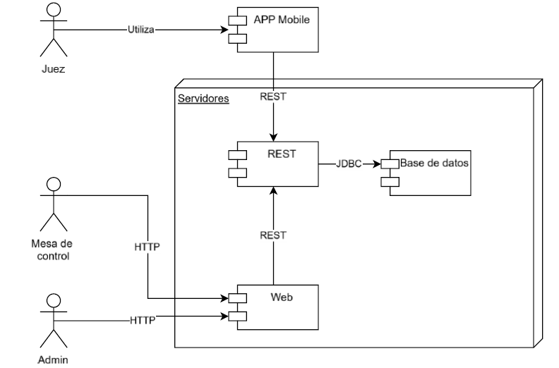
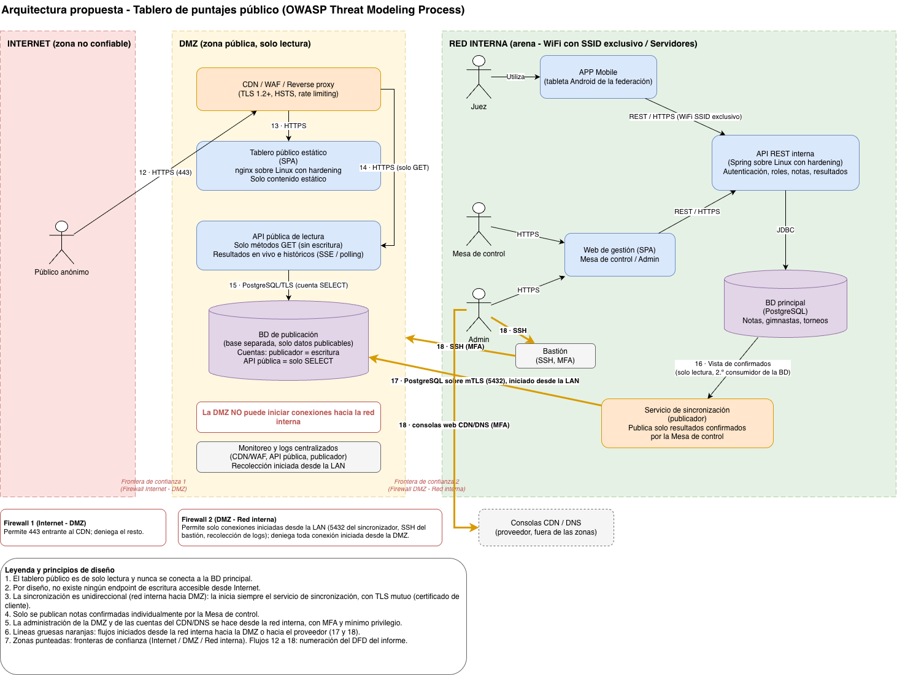
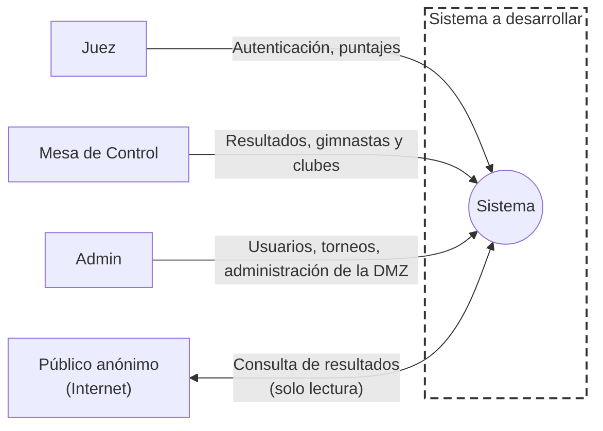
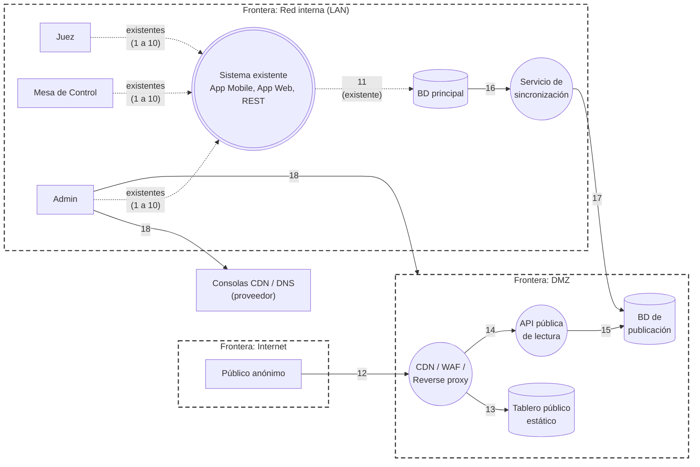

<!-- ============================================================ -->
<!-- CARÁTULA -->
<!-- ============================================================ -->

# Universidad Católica del Uruguay

### Desarrollo de Software Seguro

# Práctico 5 - Diseño Seguro - OWASP Threat Modeling Process

**Valentina Blanco**

**Belén Kanas** 

**Profesores:** 

Wiler Alvez

Alejandro Piccardo

**7 de Noviembre de 2026**

----------

<!-- ============================================================ -->
<!-- Índice -->
<!-- ============================================================ -->

## Índice

* [Introducción](#introduccion)
* [Diagrama de Arquitectura](#diagrama-de-arquitectura)
* [Modelo de Amenazas](#modelo-de-amenazas)
    * [Paso 1: Determinar el alcance](#paso-1)
    * [Paso 2: Determinar amenazas](#paso-2)
    * [Paso 3: Determinar las contramedidas y mitigaciones](#paso-3)
    * [Paso 4: Evaluar el análisis realizado](#paso-4)
* [Conclusiones](#conclusiones)

----------

## Introducción

El presente práctico tiene como objetivo aplicar una nueva iteración del **OWASP Threat Modeling Process** sobre el sistema de gestión de torneos de una federación deportiva, analizado en el teórico, al cual se le incorpora un tablero de puntajes público en Internet. El entregable comprende un diagrama de arquitectura que soporte el nuevo requerimiento y una nueva versión del modelo de amenazas, con los riesgos y las mitigaciones asociados. El diagrama de arquitectura se elaboró con draw.io y los diagramas de flujo de datos con Mermaid, que permite mantenerlos como texto dentro de este documento.

La federación incorpora un tablero de puntajes público, accesible desde una URL, con resultados en vivo y de torneos anteriores. 

> “En vivo” significa que cada nota se publica apenas la Mesa de Control la confirma, no en el momento en que la ingresa el juez.

**Preocupación del presidente:** Que alguien modifique desde Internet la nota de una gimnasta.

**Objetivos de negocio de esta iteración:**

1. Integridad de los puntajes publicados
2. Disponibilidad del tablero durante la competencia
3. Transparencia (principio de equidad deportiva)
4. Protección de datos personales (Ley N.º 18.331)
5. Reputación de la federación

### Metodología

El análisis adopta la perspectiva de un potencial atacante, en lugar de la del defensor, y sigue los cuatro pasos del OWASP Threat Modeling Process. El resultado es este documento, que detalla cada paso y sus resultados.

1. **Determinar el alcance (descomponer la aplicación).** Se recopila el diagrama de arquitectura y se dibujan los diagramas de flujo de datos (DFD) en notación Yourdon, con actores externos, procesos, almacenes de datos, flujos y fronteras de confianza. Sobre esa base se identifican:
   * las **dependencias externas**, es decir, los elementos distintos del código fuente que definen el ambiente de ejecución, cada una con un ID y una descripción;
   * los **puntos de entrada** que un adversario podría utilizar;
   * los **activos**, entendidos como cualquier elemento que se quiera proteger, desde un dato hasta un servidor;
   * los **niveles de confianza**, que representan los niveles de acceso otorgados a terceras entidades.

2. **Determinar amenazas**. Se aplica **STRIDE** sobre cada componente y flujo de los DFD, y las amenazas se priorizan con **DREAD**, expresando el resultado con la escala cualitativa de **CVSS v4.0**. Las tres herramientas se describen en el Paso 2.

3. **Determinar las contramedidas y mitigaciones.** Para cada amenaza se selecciona un tratamiento, considerando la probabilidad del ataque, el daño que puede causar, el costo de implementar la contramedida y la complejidad de operarla:
   * **Aceptar:** el impacto en el negocio se considera tolerable y no se realiza otra acción. La decisión corresponde al dueño del proceso de negocio y nunca se toma exclusivamente desde el punto de vista técnico.
   * **Eliminar:** se suprime el componente o la funcionalidad que introduce el riesgo.
   * **Mitigar:** se agregan validaciones, controles u otras modificaciones que reducen el impacto. Como resultado, se obtiene un riesgo residual.
   * **Transferir:** el riesgo se traslada a un tercero, como un seguro o un proveedor que se encargue de la funcionalidad o del activo.

4. **Evaluar el análisis realizado.** Se verifica si alguna amenaza supera el umbral de riesgo residual definido en el Paso 3. Si ninguna lo supera y se cuenta con la lista de controles a implementar, el análisis se considera concluido. En caso contrario, se requiere una nueva iteración.

---

<!-- ============================================================ -->
<!-- Diagrama de Arquitectura -->
<!-- ============================================================ -->

## Diagrama de Arquitectura

### Arquitectura anterior

El sistema analizado en el teórico estaba pensado para uso interno de la federación. Su arquitectura, que muestra la Figura 1, tenía cuatro componentes: una App Mobile y, dentro del bloque de servidores, el servicio REST, la aplicación Web y la base de datos.

- Los **jueces** utilizaban la App Mobile en tabletas de la federación y enviaban las notas al servicio REST.
- La **Mesa de Control** y el **Administrador** accedían a la aplicación Web por HTTP, y esta consumía el servicio REST.
- El servicio REST era el único que accedía a la base de datos, mediante JDBC.

Todos los componentes de servidor residían en una única zona ("Servidores"). No existía segmentación de red ni ningún componente expuesto a Internet, ya que el acceso se limitaba a los usuarios autenticados conectados a la red local de la arena.

*Figura 1: Arquitectura anterior del sistema de gestión de torneos*

### Arquitectura propuesta

La arquitectura propuesta conserva los componentes existentes (App Mobile, Web, API REST y base de datos), que permanecen en la red interna y siguen sin ser accesibles desde Internet. Sus diferencias con la arquitectura anterior son las siguientes:

- **Nuevo actor:** se incorpora el público anónimo de Internet, que solo puede consultar resultados.
- **Segmentación en tres zonas** separadas por firewalls (Internet, DMZ y red interna), en lugar de una única zona de servidores.
- **Nueva zona DMZ**, con CDN/WAF/reverse proxy, tablero público (SPA estática en nginx), API pública de **solo lectura** (solo GET), BD de publicación y monitoreo y logs.
- **Nueva BD de publicación**, separada de la BD principal, con solo datos publicables.
- **Nuevo servicio de sincronización (publicador)** en la red interna, que es el único vínculo entre ambas zonas. Siempre inicia él la conexión hacia la BD de publicación, con TLS mutuo (certificado de cliente), por lo que el flujo es unidireccional.

Las zonas son las siguientes:

- **Internet:** público anónimo (navegador), que accede por HTTPS.
- **DMZ:** CDN/WAF/reverse proxy, tablero público (SPA estática en nginx), API pública de **solo lectura** (solo GET), BD de publicación (base separada con datos publicables) y monitoreo y logs.
- **Red interna (arena, WiFi con SSID exclusivo):** App Mobile del Juez, Web de Mesa de Control/Admin, API REST interna, BD principal (PostgreSQL) y servicio de sincronización (publicador).

*Figura 2: Arquitectura propuesta para el tablero de puntajes público*

> También se puede acceder al archivo original desde [diagrama_arquitectura_tablero_publico.drawio](drawio/diagrama_arquitectura_tablero_publico.drawio)

### Principios de diseño

1. El tablero público nunca se conecta a la BD principal.
2. Por diseño, no existe ningún endpoint de escritura accesible desde Internet.
3. La sincronización es unidireccional (red interna → DMZ): la inicia siempre el servicio de sincronización, con TLS mutuo (certificado de cliente).
4. La DMZ no puede iniciar conexiones hacia la red interna.
5. Solo se publican notas confirmadas individualmente por la Mesa de Control.
6. La BD de publicación es una base separada, no una réplica de la principal, y contiene solo datos publicables. Tiene dos cuentas: el publicador (única con escritura) y la API pública (solo SELECT).
7. La administración de la DMZ y de las cuentas del CDN/DNS se hace desde la red interna, con MFA y mínimo privilegio.

---

<!-- ============================================================ -->
<!-- Modelo de Amenazas -->
<!-- ============================================================ -->

## Modelo de Amenazas

### Paso 1: Determinar el alcance

#### Dependencias externas nuevas

Siguiendo la numeración del modelo de amenazas anterior:

| ID | Descripción |
|---|---|
| 6 | Tablero público (SPA) en nginx sobre Linux con hardening, en la DMZ. Solo contenido estático. |
| 7 | API pública de lectura sobre Linux con hardening en la DMZ, con usuario de BD de solo lectura. |
| 8 | BD de publicación: base PostgreSQL separada en la DMZ, solo con datos publicables. Cuentas: publicador (escritura) y API pública (solo SELECT). |
| 9 | CDN/WAF/reverse proxy con TLS 1.2 o superior. |
| 10 | Canal de sincronización unidireccional: conexión PostgreSQL iniciada desde la red interna, con TLS y certificado de cliente (mTLS). |
| 11 | DNS y certificado TLS de la URL pública. |
| 12 | Firewalls entre Internet, DMZ y red interna. |
| 13 | Monitoreo y logs centralizados de la DMZ, recolectados por consulta iniciada desde la red interna (la DMZ no inicia conexiones hacia adentro). |
| 14 | Acceso administrativo a la DMZ (SSH vía bastión) y cuentas de administración del CDN/WAF y del DNS. |

#### Puntos de entrada nuevos

Siguiendo la numeración del modelo de amenazas anterior:

| ID | Nombre | Descripción | Nivel de confianza |
|---|---|---|---|
| 4 | Puerto HTTPS público | Único puerto expuesto a Internet (CDN/WAF) | (5) Anónimo de Internet |
| 4.1 | Tablero público estático | Contenido estático de la SPA | (5) |
| 4.2 | API pública: resultados en vivo | GET (SSE o polling) | (5) |
| 4.3 | API pública: históricos | GET de torneos anteriores | (5) |
| 5 | Canal de sincronización | Conexión PostgreSQL con mTLS para publicar resultados confirmados | (6) Servicio de sincronización |
| 6 | SSH y consolas de administración | Acceso administrativo a la DMZ y a las consolas del CDN/DNS | (2) Administrador |

#### Niveles de confianza

Se mantienen:
1. Anónimo de la red local
2. Administrador
3. Mesa de Control
4. Juez

Se agregan:

5. Anónimo de Internet: Solo lectura de datos publicados.
6. Servicio de sincronización: cuenta de servicio sin privilegios de administración.

#### Activos principales

Notas de los gimnastas (integridad, crítico), resultados publicados, datos personales de gimnastas y jueces, credenciales y claves del canal de sincronización, disponibilidad del tablero, aislamiento de la red interna, las cuentas administrativas de la DMZ, del CDN y del DNS.

#### DFD nivel 1

El DFD nivel 1 representa el sistema como un único proceso, dentro de la frontera "Sistema a desarrollar". Respecto de la versión anterior, se incorpora el actor externo **Público anónimo**, que accede desde Internet y solo puede consultar resultados.

*Figura 3: DFD nivel 1*

#### DFD nivel 2

El DFD nivel 2 detalla los componentes nuevos y su relación con el sistema existente, delimitados por tres fronteras de confianza: Internet, DMZ y red interna (LAN). El sistema existente (App Mobile, App Web y REST) se representa como un proceso múltiple, porque sus flujos 1 a 11 no cambian. Los flujos **12** (Internet → DMZ), **17** y **18** (red interna → DMZ y hacia las consolas del proveedor) cruzan fronteras de confianza. El flujo **16** ocurre dentro de la red interna y los flujos **13**, **14** y **15** dentro de la DMZ.

Notación Yourdon: el cuadrado es un actor externo, el círculo un proceso, el doble círculo un proceso múltiple, el cilindro un almacén de datos y la línea punteada gruesa una frontera de confianza. Las líneas punteadas corresponden a flujos existentes.

*Figura 4: DFD nivel 2*

#### Flujos del DFD nivel 2

Los flujos nuevos continúan la numeración del DFD nivel 2 existente.

- **1 a 11** - Sin cambios respecto del DFD nivel 2 existente (incluye 11 - REST -> BD principal: Usuarios, passwords, notas, gimnastas, torneos)
- **12** - Público -> CDN/WAF: Pedidos HTTPS de lectura
- **13** - CDN/WAF -> Tablero estático: Contenido estático (SPA)
- **14** - CDN/WAF -> API pública: GET de resultados en vivo e históricos
- **15** - API pública -> BD de publicación: Consultas SELECT
- **16** - BD principal -> Servicio de sincronización: notas confirmadas, leídas con una cuenta de solo lectura sobre una vista que contiene únicamente resultados confirmados. Es un segundo consumidor de la BD principal, además del servicio REST
- **17** - Servicio de sincronización -> BD de publicación: escritura de resultados confirmados por PostgreSQL con mTLS, iniciada desde la red interna
- **18** - Admin -> DMZ (SSH vía bastión) y Admin -> consolas web del CDN/DNS (proveedor, fuera de la DMZ), ambos con MFA

### Paso 2: Determinar amenazas

En este paso se identifican las amenazas que podrían afectar a los componentes y flujos nuevos (flujos 12 a 18 del DFD nivel 2, más el flujo existente 11 en el caso de T20) y se las ordena según su gravedad. Para ello se emplean tres herramientas, que se describen a continuación para facilitar la lectura del informe.

#### STRIDE: identificación de amenazas

**STRIDE** es una metodología desarrollada en Microsoft que clasifica las amenazas en seis categorías, cuyas iniciales forman su nombre. Se aplica recorriendo cada componente y cada flujo del DFD y preguntándose, para cada categoría, qué podría salir mal. Es un ejercicio que promueve pensar el sistema como lo haría un atacante.

| Categoría | Significado | Ejemplo en este sistema |
| --- | --- | --- |
| **S**poofing (suplantación de identidad) | Hacerse pasar por otro usuario, dispositivo o sistema | Suplantar al servicio de sincronización o crear un sitio falso que imite al tablero |
| **T**ampering (manipulación de datos) | Alterar datos o configuraciones sin autorización | Modificar la nota de una gimnasta |
| **R**epudiation (repudio) | Negar haber realizado una acción, sin que exista evidencia que lo contradiga | Cambiar una nota sin que quede registro de quién lo hizo |
| **I**nformation disclosure (revelación de información) | Exponer datos a quienes no deberían verlos | Que la API pública devuelva datos personales o notas aún no confirmadas |
| **D**enial of service (denegación de servicio) | Dejar el sistema fuera de servicio o degradado | Saturar el tablero durante el torneo |
| **E**levation of privilege (elevación de privilegios) | Obtener más permisos de los autorizados | Comprometer la DMZ y llegar desde allí a la red interna |

#### DREAD: priorización de amenazas

No todas las amenazas tienen la misma gravedad, por lo que se las prioriza con **DREAD**. Este método asigna a cada amenaza un puntaje del 1 al 10 en cinco métricas, siempre en el siguiente orden:

| Métrica | Pregunta que responde | Un 10 significa |
| --- | --- | --- |
| **D**amage (daño) | ¿Cuánto daño puede causar? | Elude todos los controles y obtiene control total |
| **R**eproducibility (reproducibilidad) | ¿Qué tan fácil es repetir el ataque? | Funciona siempre |
| **E**xploitability (explotabilidad) | ¿Cuánto esfuerzo y experiencia requiere? | Un principiante con una computadora común puede hacerlo |
| **A**ffected users (usuarios afectados) | ¿Cuánta gente se ve afectada? | Afecta a todos los usuarios |
| **D**iscoverability (detectabilidad) | ¿Qué tan fácil es descubrir la debilidad? | Es muy fácil de encontrar |

El puntaje final de cada amenaza es el promedio de las cinco métricas. Por ejemplo, para T1 se calcula (10 + 8 + 5 + 10 + 10) / 5 = 8.6. Discoverability se asume en 10 salvo que haya una buena razón para otro valor, de modo que el resto de las métricas determine el orden. Se valora el riesgo inherente, es decir, el riesgo antes de aplicar las mitigaciones propuestas.

#### CVSS: nivel de severidad

**CVSS** (Common Vulnerability Scoring System) es un estándar abierto, mantenido por FIRST (Forum of Incident Response and Security Teams), que se usa para comunicar la gravedad de las vulnerabilidades con un puntaje de 0.0 a 10.0. En este informe no se calculó un puntaje CVSS completo: se utiliza únicamente su escala cualitativa (versión 4.0) para traducir el puntaje DREAD a un nivel de severidad fácil de interpretar:

- **Crítica - 9.0 a 10.0**
- **Alta - 7.0 a 8.9**
- **Media - 4.0 a 6.9**
- **Baja - 0.1 a 3.9**

Los puntajes DREAD son una estimación del equipo y pueden recalibrarse.

#### Ranking de amenazas

Cómo leer la tabla:

- **ID:** identificador fijo de cada amenaza, asignado en el orden en que se identificó. Se mantiene en los pasos siguientes. La tabla está ordenada por severidad, de mayor a menor, por lo que los ID no son correlativos.
- **Flujo:** número del flujo del DFD nivel 2 afectado.
- **DREAD (D,R,E,A,D):** puntajes de las cinco métricas, en el orden Damage, Reproducibility, Exploitability, Affected users y Discoverability, seguidos de su promedio.

| ID | STRIDE | Amenaza | Flujo | DREAD (D,R,E,A,D) | Severidad |
| --- | --- | --- | --- | --- | --- |
| T14 | Tampering | Se publica una nota provisoria o con error de tipeo | 16-17 | (8,7,10,10,10)/5 = **9.0** | Crítica |
| T1 | Tampering | Modificar una nota desde Internet por un endpoint de escritura o método HTTP habilitado por error (violación del principio de diseño 2) | 12-15 | (10,8,5,10,10)/5 = **8.6** | Alta |
| T2 | Tampering | Inyección SQL en la API pública | 14-15 | (8,8,6,10,10)/5 = **8.4** | Alta |
| T10 | Denial of Service | DDoS o pico de tráfico durante el torneo | 12-14 | (6,8,8,10,10)/5 = **8.4** | Alta |
| T8 | Information disclosure | La API expone datos no publicables (personales, notas provisorias, identidad de jueces) | 14-15 | (8,8,5,10,10)/5 = **8.2** | Alta |
| T3 | Spoofing / Tampering | Suplantación del servicio de sincronización para publicar notas falsas | 17 | (10,6,4,10,10)/5 = **8.0** | Alta |
| T6 | Spoofing | Sitio falso (phishing, typosquatting) o secuestro de DNS | 12 | (7,8,6,9,10)/5 = **8.0** | Alta |
| T12 | Elevation of privilege | Compromiso de la DMZ y pivoteo a la red interna | 17 | (10,5,5,10,10)/5 = **8.0** | Alta |
| T19 | Spoofing / Elevation of privilege | Compromiso de las cuentas administrativas de la DMZ o del CDN/DNS (cambio de contenido servido o de registros DNS) | 18 | (10,5,4,10,10)/5 = **7.8** | Alta |
| T5 | Tampering | XSS o defacement del tablero | 13 | (6,8,5,10,10)/5 = **7.8** | Alta |
| T13 | Elevation of privilege | Explotación de software o librerías vulnerables | 13-15 | (7,6,6,10,10)/5 = **7.8** | Alta |
| T18 | Tampering | Envenenamiento de la caché del CDN: se sirven notas falsas a todos los visitantes | 12-14 | (7,5,4,10,10)/5 = **7.2** | Alta |
| T4 | Tampering | Alteración o repetición de los datos del canal de sincronización en tránsito | 17 | (7,5,3,10,10)/5 = **7.0** | Alta |
| T20 | Tampering | Insider malicioso: un usuario con acceso legítimo altera una nota antes o después de su confirmación | 11, 16-17 | (10,5,5,10,5)/5 = **7.0** | Alta |
| T7 | Tampering / Information disclosure | Interceptación del tráfico por falta de TLS | 12-14 | (3,10,5,5,10)/5 = **6.6** | Media |
| T11 | Denial of Service | Scraping masivo o conexiones SSE persistentes | 14 | (2,10,8,3,10)/5 = **6.6** | Media |
| T17 | Denial of Service | Caída o bloqueo del servicio de sincronización: los resultados en vivo dejan de actualizarse | 16-17 | (4,5,4,10,10)/5 = **6.6** | Media |
| T15 | Repudiation | Cambios o publicaciones sin trazabilidad | 16-17 | (6,10,3,5,5)/5 = **5.8** | Media |
| T9 | Information disclosure | Errores detallados o banners de versión | 13-14 | (1,10,5,2,10)/5 = **5.6** | Media |
| T16 | Information disclosure | Lectura de los mensajes de sincronización en tránsito | 17 | (5,5,3,5,10)/5 = **5.6** | Media |

#### Criterio de puntuación DREAD

Los puntajes siguen la escala del teórico (10 = peor caso). Damage se valoró según los objetivos de negocio: el 10 se reserva para quien puede alterar notas a voluntad (incluido controlar lo que ve el público) o acceder a la red interna, y los valores bajos (1 a 3) se asignan cuando solo se afecta información ya pública. Exploitability es baja (3 a 4) cuando se requiere acceso previo a zonas protegidas. Discoverability es 10 salvo en T15 y T20, que no son visibles desde afuera.

| ID | Justificación de los puntajes |
| --- | --- |
| T14 | Una nota errónea publicada afecta la clasificación y la reputación, pero es corregible: por eso D=8 y no el 10 reservado para la alteración deliberada. No requiere atacante: basta un error humano (E=10). Depende de que el error ocurra (R=7). Lo ven todos (A=10). |
| T1 | Compromete la integridad de las notas, objetivo central del sistema (D=10). Solo es posible si por error de diseño o configuración existe un endpoint de escritura o un método HTTP sin restringir, y hay que encontrarlo (E=5). |
| T2 | Permite leer o alterar la BD de publicación (D=8). Existen herramientas automáticas, pero se necesita un parámetro vulnerable (E=6). |
| T10 | Deja el tablero fuera de servicio, pero el sistema interno sigue operando (D=6). Existen servicios de DDoS al alcance de cualquiera (E=8). |
| T8 | Expone datos personales protegidos por la Ley 18.331 (D=8). Requiere encontrar el campo expuesto en la API (E=5). |
| T3 | Permite publicar notas falsas (D=10). Requiere acceso al canal y a sus credenciales, por eso la explotabilidad es baja (E=4). |
| T6 | Daña la reputación de la federación (D=7). Registrar un dominio parecido es sencillo (E=6). Afecta a quienes visitan el sitio falso (A=9). |
| T12 | Da acceso a la red interna (D=10). Requiere comprometer antes un componente de la DMZ (R=5, E=5). |
| T19 | Permite cambiar el contenido servido o redirigir el dominio (D=10). Requiere robar credenciales (R=5, E=4). |
| T5 | Muestra datos falsos en el navegador, pero no altera la base de datos (D=6). |
| T13 | El impacto depende de la vulnerabilidad concreta (D=7). Depende de las versiones instaladas (R=6) y existen exploits conocidos (E=6). |
| T18 | Permite servir notas falsas a todos los visitantes sin tocar la BD (D=7). Requiere encontrar una inconsistencia entre la clave de caché y lo que procesa el origen (E=4), y el resultado depende de la configuración (R=5). |
| T4 | Requiere acceso al canal de sincronización (E=3) y su resultado depende del momento del ataque (R=5). |
| T20 | Un usuario legítimo puede alterar una nota a voluntad (D=10). Requiere acceso y privilegios (R=5, E=5). Lo ven todos (A=10). No es visible desde afuera (Discoverability=5). | 
| T7 | Los datos son públicos, por lo que el daño es bajo (D=3). Siempre reproducible si el atacante está en la ruta de red (R=10), pero solo afecta a quienes comparten esa red (A=5). |
| T11 | Los datos son públicos (D=2). Un script simple alcanza (E=8). El efecto sobre los usuarios es marginal (A=3). |
| T17 | Los resultados en vivo quedan desactualizados, pero el sistema interno sigue operando (D=4). Lo percibe todo el público (A=10). |
| T15 | Dificulta resolver disputas (D=6). Se manifiesta siempre que falte el registro (R=10). Discoverability=5: la falta de trazabilidad no es visible desde afuera y solo se advierte ante una disputa. |
| T9 | Daño mínimo (D=1) y poca gente afectada (A=2). |
| T16 | Los datos del canal son resultados ya confirmados que están por publicarse (D=5). Requiere acceso al canal (E=3). |

### Paso 3: Determinar las contramedidas y mitigaciones

Para cada amenaza se eligió un tratamiento (aceptar, eliminar, mitigar o transferir) y se estimó el riesgo residual, es decir, el riesgo que subsiste después de aplicar las contramedidas. La elección consideró la probabilidad del ataque, el daño que puede causar, el costo de implementar la contramedida y la complejidad de operarla, cuidando que no contradiga necesidades del negocio, como la transparencia de los resultados.

**Criterio de aceptabilidad del riesgo residual:** un riesgo residual Bajo se considera aceptable. Un riesgo residual Medio solo puede aceptarse con la aprobación formal del dueño del proceso de negocio (la federación). Un riesgo residual Alto o Crítico no es aceptable y exige nuevas contramedidas.

| ID | Tratamiento | Mitigación | Riesgo residual |
| --- | --- | --- | --- |
| T14 | Mitigar | Solo se publican notas confirmadas individualmente por la Mesa de Control, de modo que “en vivo” significa que cada nota se publica apenas se confirma, sin esperar al cierre del torneo (ver Introducción). El servicio de sincronización las lee con una cuenta de solo lectura sobre una vista de confirmados (flujo 16). Las correcciones requieren doble control y quedan versionadas y visibles | Medio |
| T1 | **Eliminar** (con defensa en profundidad) | Se elimina la funcionalidad de escritura de la zona pública: por diseño no hay endpoint de escritura en la DMZ ni ruta hacia la BD principal. Como defensa adicional, la API solo acepta GET/HEAD (el WAF bloquea el resto) y usa una cuenta de BD de solo SELECT. Se verifica en pruebas que no exista ningún otro método habilitado | Bajo |
| T2 | Mitigar | Consultas parametrizadas, validación con lista blanca, cuenta de solo lectura, WAF | Bajo |
| T10 | Mitigar y Transferir | CDN con caché de 1 a 2 s, rate limiting y escalado. La parte volumétrica se transfiere a la protección anti-DDoS del proveedor del CDN. El sistema interno sigue operando si cae el tablero | Medio |
| T8 | Mitigar | BD de publicación con solo datos publicables, DTOs explícitos y revisión de privacidad previa a la publicación (ver aclaración sobre la Ley N.º 18.331) | Bajo |
| T3 | Mitigar | mTLS (certificado de cliente), cuenta del publicador con permisos mínimos (escritura solo sobre las tablas de resultados), gestor de secretos con rotación, firewall por IP y puerto y restricción de origen en el servidor PostgreSQL | Bajo |
| T6 | Mitigar | Dominio oficial, HSTS, difusión de la URL oficial por canales de la federación | Medio |
| T12 | Mitigar | Segmentación con firewall (la DMZ no inicia conexiones hacia adentro), sin credenciales internas en la DMZ, mínimo privilegio, hardening | Bajo |
| T19 | Mitigar | Administración solo desde la red interna vía bastión, MFA, cuentas nominales con mínimo privilegio, registro de sesiones. En el CDN y el DNS: MFA, bloqueo de registro del dominio y DNSSEC si es posible | Bajo |
| T5 | Mitigar | Escape de salida, CSP estricta, cabeceras de seguridad, SPA sin contenido ingresado por usuarios | Bajo |
| T13 | Mitigar | Parches, actualización de dependencias, análisis SCA en el pipeline | Bajo |
| T18 | Mitigar | Clave de caché estricta, ignorar cabeceras no incluidas en la clave, solo GET/HEAD cacheables, TTL corto y capacidad de purga inmediata | Bajo |
| T4 | Mitigar | TLS 1.2+ con mTLS (integridad y protección frente a la reutilización de sesiones), cuenta del publicador con permisos mínimos, hash de lo publicado registrado y comparable con la BD principal | Bajo |
| T20 | Mitigar | Separación de funciones (quien ingresa no confirma), doble control en correcciones, auditoría que el propio usuario no pueda modificar y alertas ante cambios posteriores a la confirmación | Medio |
| T7 | Mitigar | TLS 1.2+ obligatorio, redirección HTTP a HTTPS, HSTS, certificado de CA reconocida | Bajo |
| T11 | **Mitigar** y **Aceptar** | Se acepta el scraping razonable, porque los resultados son públicos por el principio de transparencia. Se mitiga el uso abusivo con rate limiting y límite de conexiones por cliente | Bajo |
| T17 | Mitigar | Monitoreo y alertas sobre el publicador, reintentos con cola, indicador de "última actualización" en el tablero y publicación manual de contingencia por la Mesa de Control a través del propio servicio de sincronización, sin habilitar otro canal hacia la DMZ. El sistema interno sigue operando | Bajo |
| T15 | Mitigar | Auditoría (usuario, fecha, valor anterior y nuevo, hash de lo publicado), logs centralizados y alertas | Bajo |
| T9 | Mitigar | Errores genéricos al cliente, detalle solo en logs internos | Bajo |
| T16 | Mitigar | TLS 1.2+ con mTLS en el canal, y datos con solo información publicable (sin datos personales ni notas provisorias) | Bajo |

Las aceptaciones deben ser formalizadas por el dueño del proceso de negocio (la federación) y nunca se realizan exclusivamente desde el punto de vista técnico. Esto incluye la del scraping razonable (T11) y las de los riesgos residuales Medios (T14, T10, T6 y T20).

#### Aclaración sobre la Ley N.º 18.331 (T8)

La Ley N.º 18.331, de Protección de Datos Personales, regula el tratamiento de datos personales en Uruguay. Como el tablero publica nombres de gimnastas junto con sus clubes y notas, la ley resulta aplicable. Sus requisitos principales se reflejan en el diseño de la siguiente manera:

- **Datos adecuados y no excesivos (art. 7) y finalidad (art. 8):** la BD de publicación contiene solo los datos necesarios para mostrar resultados, y la API usa DTOs explícitos. Los datos se publican únicamente para ese fin.
- **Consentimiento informado (art. 9):** el tratamiento requiere, en principio, consentimiento previo, expreso e informado. Corresponde a la federación definir y documentar la base que habilita la publicación.
- **Seguridad (art. 10):** las contramedidas de este paso buscan evitar la adulteración, la pérdida y el acceso no autorizado a los datos.
- **Inscripción (arts. 28 y 29):** quien crea una base de datos de carácter personal debe registrarla (art. 28), y toda base de datos, pública o privada, debe inscribirse en el registro del Órgano de Control, la URCDP (art. 29). La federación debe verificar la situación de la BD de publicación.

Para mayor información, se puede visitar la [página oficial de IMPO.](https://www.impo.com.uy/bases/leyes/18331-2008)

### Paso 4: Evaluar el análisis realizado

En este paso se determina si subsiste alguna amenaza cuyo riesgo residual supere el umbral de aceptabilidad definido en el Paso 3.

De las 20 amenazas analizadas, 16 quedan con riesgo residual Bajo y 4 con riesgo residual Medio. Ninguna queda con riesgo Alto o Crítico. Las cuatro con riesgo Medio requieren la aceptación formal de la federación:

- **T14 (nota errónea):** depende de un proceso humano. La mitigación técnica reduce el riesgo, pero no lo elimina.
- **T10 (DDoS):** depende de la capacidad del proveedor de CDN. El riesgo se transfiere en buena parte, pero no por completo.
- **T6 (sitio falso):** la federación no controla del todo el comportamiento de los usuarios finales.
- **T20 (insider malicioso):** un usuario con privilegios legítimos no puede neutralizarse por completo con controles técnicos. Se reduce con separación de funciones, doble control y auditoría.

Antes de la puesta en producción, las contramedidas deben verificarse con pruebas de seguridad. Por ejemplo, comprobar que la API pública rechaza cualquier método distinto de GET y HEAD, realizar pruebas de inyección SQL sobre sus parámetros y confirmar que desde la DMZ no es posible iniciar conexiones hacia la red interna.

**Conclusión de la iteración:** con el umbral definido, ninguna amenaza supera el riesgo aceptable, por lo que esta iteración se considera concluida, sujeta a la aceptación formal de T14, T10, T6 y T20. Como el desarrollo aún no ha comenzado, quedan decisiones de diseño que deberán incorporarse en una próxima iteración del modelo:

- Formalizar con la federación la aceptación de los riesgos residuales Medios (T14, T10, T6 y T20) y del scraping razonable (T11)
- Definir los umbrales de rate limiting y de conexiones SSE
- Definir la política de visibilidad de correcciones de notas
- Elegir proveedor de CDN y su SLA
- Validar con la federación qué datos de gimnastas se publican, su base de legitimación y la inscripción de la BD de publicación (Ley N.º 18.331), y evaluar el tratamiento de datos de menores, si los hubiera
- Definir el monitoreo y la respuesta a incidentes de la DMZ, e incorporar sus flujos al DFD para analizarlos con STRIDE

---

## Conclusiones

A lo largo de este práctico aplicamos una nueva iteración del **OWASP Threat Modeling Process** sobre el tablero de puntajes público, desde la descomposición de la arquitectura hasta la evaluación del riesgo residual.

- **Alcance:** el tablero incorpora un nuevo actor (el público anónimo) y una zona expuesta a Internet (la DMZ). Los diagramas de flujo de datos permitieron delimitar los siete flujos nuevos (12 a 18) y las fronteras de confianza entre Internet, la DMZ y la red interna.
- **Amenazas:** con STRIDE se identificaron 20 amenazas, que DREAD priorizó en 1 Crítica, 13 Altas y 6 Medias. La más grave (T14) no es un ataque externo, sino la publicación de una nota provisoria o con error de tipeo.
- **Mitigaciones:** la preocupación del presidente (T1) se trató eliminando la funcionalidad de escritura de la zona pública, con controles adicionales como defensa en profundidad. El resto se mitigó, y T10 se transfirió parcialmente al proveedor de CDN. De T11 se aceptó el scraping razonable.
- **Riesgo residual:** 16 amenazas quedan con riesgo Bajo y 4 con riesgo Medio (T14, T10, T6 y T20), que requieren la aceptación formal de la federación.

En síntesis, la arquitectura propuesta elimina el principal vector de la preocupación del presidente: el tablero público es de solo lectura, por diseño no tiene endpoints de escritura, no accede a la BD principal y solo recibe datos ya confirmados por un canal unidireccional autenticado. Así, la modificación de una nota desde Internet queda con un riesgo residual Bajo. Los riesgos remanentes más relevantes son de otra naturaleza: los errores y abusos en el proceso humano de carga y publicación de notas, y la disponibilidad ante ataques de denegación de servicio, que depende en buena medida del proveedor de CDN. Las decisiones de diseño y las verificaciones pendientes se incorporarán en una próxima iteración del modelo, a medida que avance el desarrollo.

---

> Valentina Blanco & Belén Kanas | Desarrollo de Software Seguro 2026
